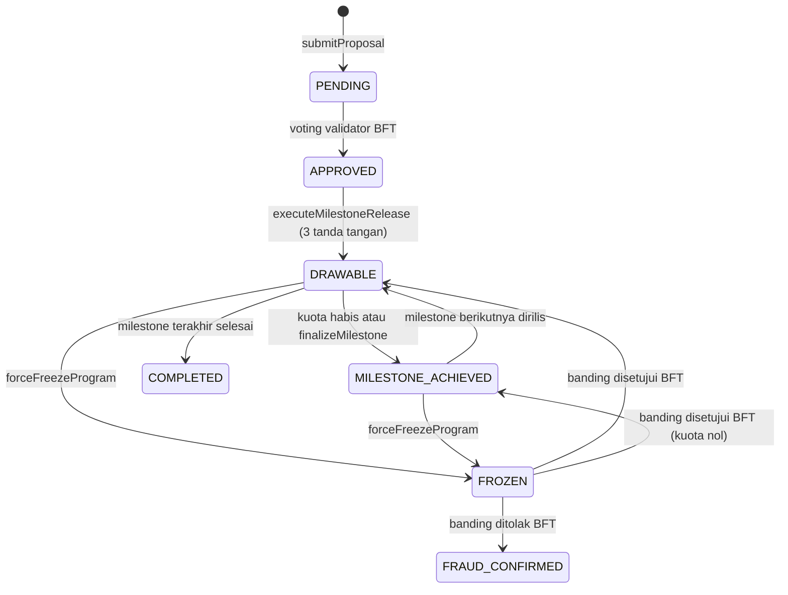
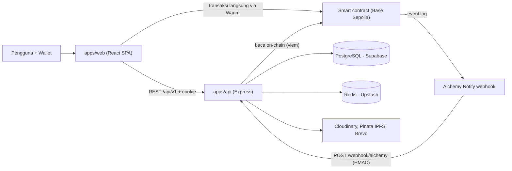

# GovernanceFund

> Sistem tata kelola dana institusi **hibrida Web2 + Web3** untuk mencegah penggelapan dana dan
> pemalsuan dokumen pada pengelolaan anggaran pemerintah atau organisasi. Blockchain menjadi
> sumber kebenaran yang anti-manipulasi; Web2 menangani antarmuka, administrasi, dan data besar.

<p align="left">
  
  
  
  
  
  
  
  
</p>

> **Catatan penamaan:** repo GitHub bernama `governancefund`, namun kontrak Solidity inti memakai
> nama teknis `Web3Governance` (domain EIP-712: `GovernanceAntiCorruption`). Nama aplikasi dan
> nama kontrak memang sengaja berbeda.

## Daftar Isi

1. [Ringkasan](#ringkasan)
2. [Status Proyek](#status-proyek)
3. [Permasalahan yang Dipecahkan](#permasalahan-yang-dipecahkan)
4. [Mekanisme Keamanan Inti](#mekanisme-keamanan-inti)
5. [Konsep Kunci: Batas Kepercayaan Web2 vs Web3](#konsep-kunci-batas-kepercayaan-web2-vs-web3)
6. [Peran dalam Sistem](#peran-dalam-sistem)
7. [Siklus Hidup Program](#siklus-hidup-program)
8. [Arsitektur dan Struktur Monorepo](#arsitektur-dan-struktur-monorepo)
9. [Tech Stack Saat Ini](#tech-stack-saat-ini)
10. [Rekomendasi Stack Target: Go + Vue (+ Desktop & Mobile)](#rekomendasi-stack-target-go--vue--desktop--mobile)
11. [Memulai (Instalasi Lokal)](#memulai-instalasi-lokal)
12. [Kontrak Ter-deploy](#kontrak-ter-deploy)
13. [Known Limitations](#known-limitations)
14. [Roadmap Pengembangan Berkelanjutan](#roadmap-pengembangan-berkelanjutan)
15. [Dokumentasi per Paket](#dokumentasi-per-paket)
16. [Lisensi](#lisensi)

---

## Ringkasan

**GovernanceFund** menggabungkan kenyamanan *user experience* Web2 dengan keamanan kriptografis
on-chain Web3. Aplikasi ini bersifat institusional-internal, dilengkapi **Public Budget Explorer**
(tanpa login) agar publik dapat memantau peredaran dana secara transparan, termasuk tab **Fraud**
yang justru mengekspos upaya kecurangan yang terdeteksi.

**Tesis inti:** audit tradisional menemukan kecurangan *setelah* uang hilang. Sistem ini membuat
kecurangan **mustahil secara mekanis sebelum terjadi**:

- Semua operasi yang berkaitan dengan perpindahan nilai (dana) wajib melewati konsensus **on-chain**
  (smart contract di Base Sepolia).
- Operasi administratif, tampilan antarmuka, dan data besar dikelola oleh arsitektur **Web2**
  (React, Express, PostgreSQL) dengan **Hash Anchoring** untuk memastikan integritas data.
- Tidak ada satu orang pun yang dapat memindahkan dana sendirian, dan aktivitas mencurigakan dapat
  dibekukan seketika oleh auditor independen.

Sistem beroperasi dengan membagi wewenang ke dalam **5 peran** (User, Admin, Validator, Auditor,
PIC) yang saling memvalidasi.

## Status Proyek

| Aspek | Status |
|---|---|
| Fase pengembangan | **Selesai** untuk cakupan saat ini; dokumentasi ini bersifat informatif |
| Jaringan | **Base Sepolia testnet** (chainId `84532`), belum mainnet |
| Sifat proyek | Akademik/paper; rekomendasi lanjutan ada di [Roadmap](#roadmap-pengembangan-berkelanjutan) |
| Stack yang berjalan | TypeScript end-to-end (Express + React); rekomendasi Go + Vue ada di [bagian khusus](#rekomendasi-stack-target-go--vue--desktop--mobile) |

## Permasalahan yang Dipecahkan

| Masalah klasik | Solusi GovernanceFund |
|---|---|
| Satu pejabat bisa mencairkan dana sepihak | **Multi-sig on-chain**: 3 tanda tangan EIP-712 unik (Admin + Validator + Auditor) per milestone |
| Kongkalikong lintas tahap pencairan | **Mitigasi kolusi**: tiap milestone berikutnya wajib 3 penanda tangan yang belum pernah menandatangani milestone mana pun pada program yang sama |
| Persetujuan program tidak transparan | **Voting Validator 67% BFT** on-chain |
| Dokumen bukti bisa dipalsukan/diganti | **Hash anchoring**: SHA-256 data program ditambatkan on-chain, diverifikasi ulang tiap webhook dan rekonsiliasi |
| Data Web2 diam-diam diubah/dihapus | **Orphan detection + rekonsiliasi**: ketidakcocokan menghasilkan status `HASH_MISMATCH` / `ORPHAN` dan program masuk tab `FLAGGED` |
| Fraud baru ketahuan setelah dana hilang | **Freeze instan** oleh satu auditor independen + banding dua-arah (approve/reject) berbasis voting validator |
| Token bisa dijual/dialihkan bebas | **Token non-transferable** (eIDR): hanya bisa dikirim ke/dari gateway untuk penebusan |

## Mekanisme Keamanan Inti

1. **Multi-sig EIP-712 berantai.** Pencairan dana tidak bisa dilakukan sepihak. Setiap milestone
   membutuhkan 3 tanda tangan kriptografis unik (Admin + Validator + Auditor).
2. **Mitigasi kolusi (The Oracle Problem).** Untuk mencegah kebohongan yang disepakati bersama,
   pencairan milestone berikutnya mewajibkan 3 aktor yang berbeda dari milestone sebelumnya. Ini
   memaksa PIC mencari komplotan baru di setiap tahap, sehingga biaya dan kesulitan kongkalikong
   skala besar meningkat drastis. *(Implementasi: `historyOfSigners[programId][signer]` pada
   `Web3Governance`, berlaku mulai milestone indeks 1.)*
3. **Konsensus BFT 67%.** Persetujuan program dan manajemen peran memerlukan persetujuan 67%
   Validator/Admin aktif on-chain. *(Ambang: `⌊2N/3⌋ + 1`.)*
4. **Hash Anchoring & Orphan Detection.** Data program di-hash (SHA-256) dan ditambatkan on-chain.
   Perubahan diam-diam di database Web2 terdeteksi sebagai *mismatch* oleh mesin rekonsiliasi dan
   memicu status `HASH_MISMATCH` atau `ORPHAN` (tab `FLAGGED`).
5. **Freeze instan & sistem reputasi.** Fungsi `onlyRole(AUDITOR)` memungkinkan **satu** auditor
   independen langsung membekukan program yang mencurigakan. Auditor diberi skor reputasi
   berdasarkan akurasi tindakannya, dengan potensi insentif nyata dari keberhasilan pemulihan aset
   (misalnya lewat pengadilan).

Lapisan pendukung lain: trigger PostgreSQL yang menolak perubahan data program tersegel, token
non-transferable, kedaluwarsa proposal 7 hari on-chain, *cumulative budget guard* on-chain, sanitasi
stored-XSS, cookie sesi `httpOnly`, rate limiting, dan **Cloudflare Turnstile** pada endpoint auth
(aktif hanya di production).

## Konsep Kunci: Batas Kepercayaan Web2 vs Web3

Smart contract bersifat **publik dan permissionless**: siapa pun yang tahu alamat + ABI bisa
memanggil fungsi langsung (via Etherscan/script), melewati frontend. **Guard Web2 selalu bisa
di-bypass; ini diterima secara desain.**

> **Prinsip:** yang melindungi **DANA** harus on-chain; yang melindungi **UX** boleh di Web2.

Pem-bypass yang memanggil `submitProposal()` langsung tetap **tidak bisa memindahkan uang**, karena
pencairan butuh voting 67% validator (on-chain) dan 3 tanda tangan EIP-712 (on-chain) yang tak bisa
ia kendalikan atau palsukan. Hasilnya hanya proposal `PENDING` yang tak berguna, dan backend
meng-cross-check setiap event on-chain terhadap database lalu mengklasifikasikannya (lihat
*Orphan Detection*).

| Aksi | Dilindungi oleh |
|---|---|
| Mint token (pencairan) | 3 tanda tangan EIP-712 on-chain |
| Setujui program | Voting 67% validator on-chain |
| Grant/revoke role Admin/Validator/Auditor | Voting 67% admin on-chain |
| Freeze program | `onlyRole(AUDITOR_ROLE)` on-chain |
| Unfreeze / konfirmasi fraud | Voting dua-arah 67% validator on-chain |
| Siapa boleh submit proposal | `onlyRole(PIC_ROLE)` on-chain + verifikasi identitas Web2 |
| Siapa boleh menyelesaikan penebusan fiat | Alamat `gatewayOwner` (operator) on-chain |

## Peran dalam Sistem

Satu alamat wallet hanya boleh memegang **satu peran struktural** (ditegakkan on-chain).

| Peran | Wewenang | Catatan |
|---|---|---|
| **User** | Akun default: registrasi, verifikasi email, bind wallet, ubah profil | Tanpa kuasa governance; dipromosikan lewat voting admin |
| **Admin** (multi) | Usul + voting grant/revoke role (BFT 67%); grant/revoke **PIC** (satu admin, tanpa voting); verifikasi identitas user (Web2); 1 dari 3 penanda tangan milestone | Minimal 1 admin (root admin = deployer) |
| **Validator** (multi) | Voting persetujuan proposal; voting banding unfreeze; 1 dari 3 penanda tangan milestone | Minimal **3 validator** agar `submitProposal` bisa dipanggil |
| **Auditor** | Satu-satunya kuasa: **freeze** program; lampirkan bukti freeze (Web2); 1 dari 3 penanda tangan milestone | Independen; punya skor reputasi |
| **PIC** (Person in Charge) | Buat program (Web2), `submitProposal`, kumpulkan 3 tanda tangan, `executeMilestoneRelease`, tarik dana bertahap, `finalizeMilestone`, ajukan banding, tebus token di gateway | `PIC_ROLE` di-grant satu admin tanpa voting; punya skor reputasi |

Di luar kelima peran tersebut ada **operator gateway** (`gatewayOwner` pada `TrustedGatewayBurner`,
secara default alamat deployer). Operator inilah yang mengonfirmasi penebusan fiat setelah bank
membayar.

**Reputasi** (disimpan di Web2, diturunkan *eksklusif* dari event on-chain; skor awal 75, dibatasi
0–100):

| Kejadian | Pihak | Perubahan |
|---|---|---|
| Program selesai (`ProgramCompleted`) | PIC | +15 |
| Milestone difinalisasi (`MilestoneFinalized`) | PIC | +5 |
| Fraud terbukti (`ProgramFraudConfirmed`) | PIC | -60 |
| Freeze valid (fraud terbukti) | Auditor | +20 |
| Freeze keliru (banding disetujui, `ProgramUnfrozenViaBFT`) | Auditor | -20 |

PIC dengan skor di bawah **35** tidak dapat membuat program baru (dicek di Web2).

## Siklus Hidup Program



Langkah end-to-end:

1. **Onboarding (Web2).** User registrasi (+ Turnstile di production), verifikasi email, mengisi
   profil (NIK 16 digit, dsb.), lalu mengikat wallet lewat tanda tangan pesan bernonce. Admin
   memverifikasi identitas dan meng-grant `PIC_ROLE` on-chain.
2. **Buat program (Web2).** PIC mengisi data program + rencana milestone. Jumlah anggaran milestone
   harus sama dengan `totalBudget`. Backend menghitung `programHash` (SHA-256 atas 15 field
   kanonik).
3. **Tambatkan on-chain.** PIC memanggil `submitProposal(programId, programHash, totalBudget,
   milestoneCount)`. Webhook memverifikasi ulang hash: cocok → `VERIFIED`; beda → `HASH_MISMATCH`;
   tak ada pasangan Web2 → `ORPHAN` (keduanya masuk tab `FLAGGED`).
4. **Voting.** Validator memberi suara dalam 7 hari; ambang `⌊2N/3⌋ + 1` → `APPROVED`.
5. **Rilis milestone.** Admin, Validator, dan Auditor masing-masing menandatangani EIP-712
   `MilestoneApproval` (dikumpulkan off-chain), lalu PIC mengirimnya sekaligus lewat
   `executeMilestoneRelease` → `DRAWABLE`.
6. **Penarikan bertahap.** `executePicWithdrawal` mencatat penerima + deskripsi on-chain dan
   **mencetak (mint) eIDR sesuai kebutuhan**. Kuota habis atau `finalizeMilestone` → milestone
   berikutnya; milestone terakhir → `COMPLETED`.
7. **Penebusan fiat (dua fase).** PIC mengirim eIDR ke escrow gateway (`requestRedemption`); setelah
   bank membayar rupiah, operator memanggil `confirmRedemption` yang membakar token. Bila operator
   tidak menyelesaikan, token dikembalikan (`cancelRedemption`).
8. **Jalur fraud.** Auditor `forceFreezeProgram` → PIC dapat `proposeUnfreezeAppeal` → validator
   voting dua arah: approve → program lanjut, reject → `FRAUD_CONFIRMED`.

## Arsitektur dan Struktur Monorepo



Prinsip aliran data: **aksi finansial tidak punya endpoint REST**. Frontend menulis langsung ke
kontrak, menunggu receipt, lalu *polling* sampai webhook memperbarui backend (tidak pernah
optimistic-success).

```
governancefund/
├── apps/
│   ├── web/          # Frontend: Vite + React 18 SPA            (README sendiri)
│   └── api/          # Backend:  Express 4 + TypeScript          (README sendiri)
├── packages/
│   ├── blockchain/   # Smart contract: Hardhat 3 + Solidity     (README sendiri)
│   ├── database/     # Prisma schema + client + seed + trigger  (README sendiri)
│   └── shared/       # ABI, EIP-712, alamat kontrak, programHash (README sendiri)
├── turbo.json        # Pipeline Turborepo (dev, build, compile, typecheck, db:generate)
├── pnpm-workspace.yaml
└── package.json      # Root workspace (pnpm 9.12.1)
```

**Aliran ABI:** Hardhat compile → artifact JSON → salin ke `packages/shared` → dipakai `apps/web`
(Wagmi) dan `apps/api` (decode webhook + read call).
**Aliran Prisma:** `schema.prisma` di `packages/database` → `prisma generate` → diimpor `apps/api`.

## Tech Stack Saat Ini

| Layer | Teknologi utama |
|---|---|
| **Frontend** (`apps/web`) | Vite 6 + React 18, React Router 7, Tailwind v4 (CSS-first) + shadcn/ui (Radix), Wagmi v2 + Viem + RainbowKit, TanStack Query v5, react-hook-form + Zod, Axios, framer-motion/GSAP/Lenis (landing), Cloudflare Turnstile |
| **Backend** (`apps/api`) | Express 4.21 + TypeScript (dijalankan via `tsx`), Prisma, **worker outbox berbasis PostgreSQL** (in-process), cache in-memory, Redis (Upstash) untuk rate limiter + blocklist JWT, JWT (cookie `httpOnly`), Brevo HTTP API, Pino, Sentry, viem, Cloudinary + Pinata (IPFS) |
| **Blockchain** (`packages/blockchain`) | Solidity 0.8.35, Hardhat 3, OpenZeppelin v5 (EIP712, ECDSA, AccessControl, ERC20), Ethers (script Hardhat) + viem (skrip utilitas) |
| **Database** | Supabase PostgreSQL via Prisma 5.20 (transaction pooler + session pooler) |
| **Infra** | Vercel (FE), Railway (BE), Upstash Redis, Alchemy Notify webhook |
| **Tooling** | pnpm 9.12.1 workspaces, Turborepo 2.1.2, TypeScript 7.0.2 |

## Rekomendasi Stack Target: Go + Vue (+ Desktop & Mobile)

> **Penting:** bagian ini adalah **rekomendasi arah pengembangan**, bukan deskripsi implementasi
> saat ini. Kode yang ada ditulis dengan TypeScript (Express + React). Smart contract
> (Solidity/Hardhat) **tidak berubah** pada skenario apa pun.

Untuk produksi jangka panjang, sistem **sebaiknya menggunakan Go (Golang) di sisi backend dan Vue di
sisi frontend**:

- **Go** cocok untuk backend institusional: binary tunggal yang mudah di-deploy, konkurensi
  (goroutine) yang natural untuk worker outbox dan rekonsiliasi, tipe statis, dan pustaka Ethereum
  resmi (`go-ethereum`) yang mendukung binding kontrak (`abigen`), `ecrecover`, dan hashing
  EIP-712 secara native.
- **Vue 3** memberi kurva belajar yang landai, reaktivitas yang ringkas, dan ekosistem Web3 yang
  sudah tersedia: `@wagmi/vue` + `viem`, serta Reown AppKit (mendukung Vue) sebagai pengganti
  RainbowKit yang khusus React.

**Pemetaan komponen (saat ini → rekomendasi):**

| Komponen | Saat ini | Rekomendasi target |
|---|---|---|
| HTTP API | Express 4 | Go + `chi` atau `gin` |
| ORM / query | Prisma | `sqlc` + `pgx` (atau Ent/GORM), migrasi dengan goose/Atlas |
| Antrean event | Outbox Postgres (`FOR UPDATE SKIP LOCKED`) | Pola outbox yang sama (goroutine worker) atau River (queue berbasis Postgres) |
| Baca/decode on-chain | viem | `go-ethereum` (`ethclient`, `abigen`) |
| Verifikasi EIP-712 | `recoverTypedDataAddress` (viem) | `apitypes.TypedData` + `crypto.Ecrecover` (go-ethereum) |
| Auth | `jsonwebtoken` + bcryptjs | `golang-jwt/jwt` + `x/crypto/bcrypt` |
| Validasi / sanitasi | Zod + sanitize-html | `go-playground/validator` + `bluemonday` |
| Logging / error | Pino + Sentry | `log/slog` (atau zerolog) + `sentry-go` |
| Frontend | React 18 + React Router | **Vue 3 + Vite + Vue Router + Pinia** |
| Server state | TanStack Query (React) | TanStack Query (Vue) |
| Wallet | Wagmi + RainbowKit | `@wagmi/vue` + Reown AppKit |
| Form | react-hook-form + Zod | vee-validate + Zod |
| Komponen UI | shadcn/ui | shadcn-vue |
| Kontrak | Solidity + Hardhat | **Tetap** (ABI sama; generate binding Go dengan `abigen`) |

**Aplikasi Desktop dan Mobile** (satu basis kode Vue dipakai ulang):

| Platform | Pilihan yang direkomendasikan | Alasan |
|---|---|---|
| **Desktop** | **Wails** (backend Go + frontend Vue dalam satu binary; v2 stabil, v3 masih beta) | Selaras dengan stack Go + Vue; binary ringan memakai WebView bawaan OS; cocok untuk konsol operator gateway dan workstation auditor. Alternatif: Tauri 2 atau Electron |
| **Mobile** | **Capacitor** membungkus SPA Vue yang sama (iOS/Android), dengan WalletConnect/Reown deep link untuk tanda tangan EIP-712 | Reuse kode web maksimal; validator/auditor dapat menandatangani dari ponsel. Alternatif: **Quasar** (berbasis Vue, satu basis kode → SPA/PWA/Capacitor/Electron). Mulai dari PWA bila ingin langkah paling murah |

**Hal yang wajib tetap identik saat migrasi** (kontrak antar-komponen):

1. Alamat kontrak, ABI, dan domain/struct EIP-712 (`GovernanceAntiCorruption` v`1`, `MilestoneApproval`).
2. Algoritma `computeProgramHash` (15 field, `|`, SHA-256). Lihat *test vector* di
   [`packages/shared/README.md`](packages/shared/README.md#test-vector-untuk-implementasi-ulang-mis-go).
3. Envelope respons `{ data, error, meta }`, prefix `/api/v1`, dan endpoint webhook `/webhook/alchemy`
   (HMAC SHA-256) agar klien lama dan baru tetap kompatibel.
4. Idempotensi event berdasarkan pasangan `(txHash, logIndex)`.

## Memulai (Instalasi Lokal)

**Prasyarat:** Node.js ≥ 20, **pnpm 9.12.1**, serta akun Supabase, Upstash, Alchemy, Cloudinary,
Pinata, dan Brevo (semua kredensial API di bawah ini **wajib** agar API dapat booting).

```bash
# 1. Clone + install seluruh workspace
git clone https://github.com/Xnaizer/governancefund.git
cd governancefund
pnpm install

# 2. Siapkan environment (salin dari .env.example di tiap paket)
#    packages/database/.env   -> DATABASE_URL, DIRECT_URL
#    apps/api/.env            -> lihat apps/api/README.md (daftar lengkap)
#    apps/web/.env            -> VITE_WC_PROJECT_ID (wajib), VITE_API_URL, dst.
#    packages/blockchain/.env -> hanya bila compile/deploy/verify

# 3. Database: generate client + push schema
pnpm --filter @repo/database db:generate
pnpm --filter @repo/database db:push
#    WAJIB: terapkan trigger imutabilitas secara manual (db:push TIDAK menjalankannya),
#    mis. lewat Supabase SQL Editor:
#    packages/database/scripts/program_immutability_trigger.sql
pnpm --filter @repo/database db:seed        # opsional (data contoh, dilarang di production)

# 4. Blockchain: compile (deploy hanya bila perlu redeploy)
pnpm --filter @repo/blockchain compile

# 5. Jalankan dev
pnpm dev                                    # semua paket yang punya script dev (Turborepo)
#    atau per aplikasi:
pnpm --filter @repo/api dev                 # http://localhost:4000
pnpm --filter @repo/web dev                 # http://localhost:3000
```

Catatan:

- Turnstile **nonaktif otomatis** di development (FE & BE), sehingga alur auth lokal bebas hambatan.
- API **tidak memiliki langkah build**; production dijalankan lewat `pnpm --filter @repo/api start`
  (`tsx src/index.ts`). Frontend memakai `pnpm --filter @repo/web build` (`tsc --noEmit && vite build`).
- Agar event on-chain masuk ke database, Alchemy Notify harus diarahkan ke
  `POST {API_URL}/webhook/alchemy` dan memakai `ALCHEMY_WEBHOOK_SECRET` yang sama.
- Script root `pnpm lint` tersisa di `package.json`, tetapi tidak ada task `lint` di `turbo.json`
  maupun linter terpasang di aplikasi. Gunakan `pnpm --filter <paket> typecheck` untuk pengecekan tipe.

## Kontrak Ter-deploy

Base Sepolia (chainId `84532`). Sumber kebenaran: [`packages/shared/src/constants/contract.ts`](packages/shared/src/constants/contract.ts).

| Kontrak | Alamat |
|---|---|
| RupiahToken (eIDR) | `0x7dc8b7C37ecDA42328105d00ae23cBD9239db0A9` |
| TrustedGatewayBurner | `0x76070Ce481c088B219FDef8F6ef0CcF91391C0A0` |
| Web3Governance | `0x89AB7D9EBefa836F44c50f51F7d2c2831188421a` |
| Deployer / root admin | `0x3ff8C245C6499062A98Ed214EA606Ec5fa2627Dd` |

Block explorer: https://sepolia.basescan.org

> Setiap redeploy kontrak, perbarui `contract.ts` **dan** `verifyingContract` di `eip712.ts`, salin
> ulang ABI, dan arahkan ulang webhook Alchemy. Detail ada di
> [`packages/blockchain/README.md`](packages/blockchain/README.md).

## Known Limitations

Batasan berikut sengaja didokumentasikan sebagai *known limitations* (bukan bug).

### Batasan arsitektural (hasil evaluasi)

- **Sybil Attack pada lapisan administratif.** Jika seorang pejabat tinggi mengontrol seed phrase
  atau private key dari banyak Validator bawahannya, konsensus 67% on-chain secara riil hanya
  dikendalikan oleh satu orang (*konsensus semu*). Mitigasi memerlukan KYC ketat dan manajemen
  kunci yang lebih baik (lihat Roadmap: Account Abstraction + staking/slashing).
- **Kickback off-chain (Fiat Blindspot).** Sistem menjamin token non-transferable (eIDR) aman hingga
  di-burn di gateway vendor. Setelah eIDR menjadi fiat di rekening bank konvensional vendor, sistem
  kehilangan visibilitas. Kickback atau uang muka di bawah meja di dunia nyata tetap bisa terjadi
  dan menjadi tanggung jawab audit konvensional.

### Batasan teknis implementasi

- **Ambang BFT dinamis.** `N` diambil live saat suara di-cast, tidak dikunci saat proposal dibuat;
  admin yang grant/revoke role di tengah voting dapat menggeser ambang. Dengan `N = 3` validator,
  ambang `⌊2N/3⌋ + 1 = 3` berarti suara bulat (unanimity).
- **Hanya testnet.** Di-deploy ke Base Sepolia (84532), belum mainnet.
- **Reputasi off-chain (Web2).** Bisa dimanipulasi bila database dibobol; dimitigasi dengan
  menurunkannya eksklusif dari event on-chain (bukan input manual). Reputasi `MILESTONE_FINALIZED`
  tidak idempoten per milestone (event duplikat yang lolos dedup bisa menghitung ganda).
- **Guard Web2 bisa di-bypass.** Memanggil kontrak langsung hanya menghasilkan proposal `ORPHAN`
  yang tak berbahaya (tak pernah tervoting/terdanai), karena otoritas finansial sepenuhnya on-chain.
- **Pencocokan anggaran.** Kontrak hanya menegakkan *cumulative guard* (Σ milestone ≤ `totalBudget`).
  Kesamaan Σ anggaran milestone dengan `totalBudget` dicek hanya saat pembuatan program di Web2.
- **Satu siklus freeze–unfreeze per program.** `appealStartedAt != 0` memblokir banding ulang;
  program yang dibekukan lagi tak bisa banding lagi (dianggap sinyal kuat).
- **`UNRESOLVED` = freeze permanen.** Bila deadline banding lewat tanpa ambang tercapai, program
  tetap `FROZEN` selamanya tanpa perubahan reputasi (tak menghakimi tanpa konsensus). PIC yang
  tidak bersalah namun validatornya apatis bisa "terdampar" (konservatif secara desain). Di
  database, nilai enum `UNRESOLVED` dicadangkan namun belum ditulis oleh kode: hasil freeze tetap
  `PENDING`. *Solusinya ada di Roadmap #4.*
- **Clawback 72 jam hanya kebijakan.** Jendela clawback pada token yang baru dicetak hanya berupa
  teks kebijakan di halaman Redeem; belum ada pengecekan teknis di API, web, maupun kontrak.
- **Operator gateway tunggal.** `gatewayOwner` adalah satu alamat (default deployer) yang
  mengonfirmasi penebusan fiat; PIC terlindungi oleh `RECLAIM_TIMEOUT` 7 hari dan jalur cancel.
- **Kuota milestone yang di-finalize tidak dikembalikan** ke pool alokasi (alokasi = komitmen).
- **Proposal kedaluwarsa tetap `PENDING`** on-chain selamanya (tak ada enum `EXPIRED`); PIC harus
  submit ulang dengan `programId` baru. Web2 menampilkannya sebagai "Expired".
- **`VOTING_PERIOD`** satu konstanta 7 hari dipakai bersama untuk voting proposal, voting role, dan
  voting unfreeze.
- **Public Explorer hanya menampilkan program `isOnChain = true`** (draft Web2 disembunyikan).
- **Konsistensi eventual.** Database baru terbarui setelah webhook diproses worker; bila
  `ENABLE_WORKERS=false`, event hanya masuk antrean dan tidak diproses.
- **Normalisasi wallet lowercase** dilakukan per-field di service layer (bukan middleware global,
  agar tak menimpa field alamat fisik `User.address`).

## Roadmap Pengembangan Berkelanjutan

Untuk menyempurnakan arsitektur dan menambal celah dari perilaku manusia, GovernanceFund akan
mengimplementasikan lapisan *cryptoeconomics* dan otomasi tingkat lanjut:

1. **Account Abstraction (EIP-4337) & Smart Accounts.** Menyelesaikan masalah manajemen kunci bagi
   pejabat institusi. Pejabat login memakai Web2 (email/biometrik), dan transaksi ditandatangani
   melalui infrastruktur Multi-Party Computation (MPC) atau paymaster. Ini meniadakan kebutuhan
   menyimpan seed phrase secara manual, meski tidak secara langsung menyelesaikan potensi Sybil
   attack tanpa KYC yang ketat.
2. **Mekanisme Staking & Slashing (*Skin in the Game*).** Validator dan Auditor wajib mendepositkan
   dana (staking) ke smart contract sebelum dapat menyetujui atau mengaudit proyek. Bila proyek
   terbukti fiktif atau korup di kemudian hari, dana stake mereka disita (*slashed*). Insentif
   ekonomi ini memaksa rasionalitas dan mencegah Auditor atau Validator bertindak sebagai
   "stempel karet" (*rubber stamp*).
3. **Decentralized Physical Oracles (verifikasi otomatis).** Mengurangi porsi kepercayaan pada
   tanda tangan manusia dengan trigger eksternal. Sign pencairan milestone lanjutan akan terkunci
   on-chain hingga menerima data valid dari API satelit (geo-tagging progres fisik) atau sensor IoT
   di lokasi proyek, memastikan kesesuaian antara dokumen digital dan realitas fisik.
4. **Dead Man's Switch Terbalik & eskalasi Super Auditor.** Memodifikasi batas waktu `UNRESOLVED`.
   Jika Validator tidak merespons (apatis) dalam 7 hari saat masa peninjauan, mereka terkena
   penalti *auto-demote* (timeout penalty), bukan membekukan program secara permanen. Selain itu
   dibangun jalur eskalasi khusus di mana "Super Auditor" eksternal dengan otoritas hukum tinggi
   (seperti KPK atau BPK) dapat melakukan *force-unfreeze* atau mengeksekusi resolusi sengketa
   secara on-chain.

Di luar cakupan saat ini (*future work*): reputasi validator, akuntabilitas signer, penalti proposal
kedaluwarsa, dan ZK proof.

## Dokumentasi per Paket

| Paket | README |
|---|---|
| Backend API | [`apps/api/README.md`](apps/api/README.md) |
| Frontend web | [`apps/web/README.md`](apps/web/README.md) |
| Smart contract | [`packages/blockchain/README.md`](packages/blockchain/README.md) |
| Database | [`packages/database/README.md`](packages/database/README.md) |
| Shared | [`packages/shared/README.md`](packages/shared/README.md) |

## Lisensi

MIT. Lihat [`LICENSE`](LICENSE).
