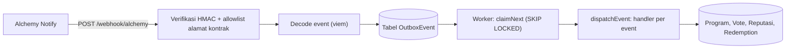

# @repo/api: Backend (Express.js + TypeScript)

REST API GovernanceFund: autentikasi, endpoint baca program/vote/user publik, **ingesti webhook
Alchemy** (sinkronisasi event on-chain → PostgreSQL), reputasi, pengumpulan tanda tangan EIP-712,
upload (Cloudinary + IPFS), dan worker asinkron berbasis **outbox PostgreSQL**.

> Bagian dari monorepo [`governancefund`](../../README.md). Mengimpor `@repo/database` (Prisma) dan
> `@repo/shared` (ABI, EIP-712, `computeProgramHash`).

## Prinsip Inti

- **Blockchain = sumber kebenaran.** Aksi finansial (submit proposal, vote, approve, freeze,
  withdraw, grant role, redeem) **tidak punya endpoint**; semuanya on-chain via Wagmi di frontend.
  Backend menyerapnya lewat webhook.
- Setiap event on-chain **di-cross-check** ke database; anomali diklasifikasikan (`ORPHAN` /
  `HASH_MISMATCH`), tidak pernah didiamkan.
- Jangan percaya data database untuk keputusan on-chain: verifikasi ulang via `ecrecover` dan view
  call (mis. `hasRole`, `proposals`).
- Role pengguna di database **mengikuti event on-chain** (grant/revoke role), bukan input manual.

## Tech Stack

Express 4.21 · **tsx** (dev dan production; tidak ada langkah build) · Prisma 5.20 · **worker outbox
PostgreSQL** (in-process) · Redis via `ioredis` (Upstash; rate limiter + blocklist JWT) · JWT
(cookie `httpOnly`, fallback header Bearer) · bcryptjs · **Brevo** HTTP API + templat EJS ·
**Pino** (log terstruktur, redaksi rahasia) · **Sentry** · **viem** (read kontrak, decode event,
verifikasi tanda tangan) · Cloudinary + **Pinata** (IPFS) · Multer · helmet · express-rate-limit ·
sanitize-html · Zod · **Cloudflare Turnstile**. Node.js ≥ 20, TypeScript 7.

## Struktur (`src/`)

```
index.ts          # entrypoint: connect DB (retry), start server + worker, graceful shutdown
instrument.ts     # inisialisasi Sentry (diimpor paling awal)
app.ts            # susunan middleware, /health, /health/deep, mount /api/v1 dan /webhook
config/           # env (validasi Zod), cloudinary, pinata
middleware/       # auth, requireRole, rateLimiter, turnstile, webhookVerify, upload, errorHandler, notFound
routes/           # auths, users, programs, signatures, uploads, public, gateway, webhook
controllers/      # handler tiap route
services/         # logika bisnis (auth, program, signature, webhook, outbox, reputation,
                  #   reconciliation, redemption, upload, ipfs, contract, vote, ...)
validators/       # skema Zod + helper sanitasi
workers/          # loop worker outbox + penjadwal rekonsiliasi + warm-up cache validator
scripts/          # skrip one-off (backfillProposalVotes, requeueFailedTransactionEvents)
templates/emails/ # templat EJS: verify-email, reset-password
postman/          # collection + environment Postman (termasuk simulasi webhook)
lib/              # prisma (+ txDirect), redis, cache, memoryCache, logger, mailer, viem
utils/            # AppError, asyncHandler, response envelope, sanitize, hash
types/            # augmentasi tipe Express (req.user)
```

## Format Respons

Semua endpoint JSON memakai envelope yang sama:

```json
{ "data": {}, "error": null, "meta": {} }
```

Saat gagal: `{ "data": null, "error": "pesan", "meta": {} }`. Semua route REST berada di bawah
prefix **`/api/v1`**; webhook berada di **`/webhook`** (di luar prefix).

## Endpoint

Singkatan: **auth** = harus login (cookie/Bearer); **Turnstile** = diverifikasi hanya di production.
Satuan angka uang adalah **rupiah utuh** (eIDR memakai 0 desimal), dikirim sebagai string numerik.

### Sistem

| Method | Path | Keterangan |
|---|---|---|
| GET | `/health` | Liveness sederhana (`"ok"`) |
| GET | `/health/deep` | Cek DB + Redis (di-cache 60 detik); `503` bila ada dependensi mati |
| POST | `/webhook/alchemy` | Webhook Alchemy (HMAC); lihat [Alur Webhook](#alur-webhook-dan-worker-outbox) |

### Auth (`/api/v1/auth`)

| Method | Path | Akses |
|---|---|---|
| POST | `/register` | publik + rate limit auth + Turnstile |
| GET | `/verify-email?token=` | publik + rate limit auth |
| POST | `/login` | publik + rate limit auth + Turnstile; men-set cookie `token` |
| POST | `/logout` | auth; token masuk blocklist Redis |
| GET | `/me` | auth |
| PATCH | `/me` | auth; ubah profil (NIK 16 digit, NIP, telepon, dst.) |
| POST | `/resend-verification` | publik + Turnstile |
| POST | `/forgot-password` | publik + Turnstile |
| POST | `/reset-password` | publik + Turnstile; semua token lama dicabut |

### Users & Wallet (`/api/v1/users`)

| Method | Path | Akses |
|---|---|---|
| GET | `/wallet/nonce` | auth; nonce berlaku 5 menit |
| POST | `/wallet/bind` | auth; tanda tangan pesan bernonce, wallet terkunci bila sudah punya role |
| GET | `/` | ADMIN; daftar user |
| GET | `/:id` | ADMIN; detail user |
| PATCH | `/:id/verify` | ADMIN; verifikasi identitas (email aktif + profil lengkap) |

### Programs (`/api/v1/programs`)

| Method | Path | Akses |
|---|---|---|
| POST | `/` | PIC; buat program Web2 + milestone |
| GET | `/` | auth; daftar program |
| GET | `/my-proposal-votes` | VALIDATOR; riwayat suara proposal milik sendiri |
| GET | `/:id` | auth; detail program |
| GET | `/:id/onchain-payload` | PIC; `programId`, `programHash`, `milestoneCount` untuk `submitProposal` |
| POST | `/:id/freeze-evidence` | AUDITOR; lampirkan alasan/bukti freeze (hanya auditor yang membekukan) |

### Signatures (`/api/v1/signatures`)

| Method | Path | Akses |
|---|---|---|
| POST | `/` | ADMIN / VALIDATOR / AUDITOR; kirim tanda tangan EIP-712 |
| GET | `/:milestoneId` | auth; status pengumpulan (`collected`, `required: 3`, `complete`) |
| DELETE | `/:milestoneId` | PIC; reset tanda tangan selama milestone masih `PLANNED` |

### Uploads (`/api/v1/uploads`)

Gambar dan avatar memakai pola **signed upload**: backend memberi parameter tanda tangan, klien
mengunggah langsung ke Cloudinary, lalu backend memverifikasi aset dan menyimpannya.

| Method | Path | Akses |
|---|---|---|
| POST | `/program/:programId/image/sign` · `/program/:programId/image` | PIC; maksimal 8 foto per program |
| PUT / DELETE | `/program/:programId/image/:imageId` | PIC |
| POST | `/program/:programId/pin-data` | PIC; pin JSON kanonik program ke IPFS (`ipfsCid`) |
| POST | `/milestone/:milestoneId/evidence` | PIC; multipart (PDF/JPEG/PNG/WebP ≤ 10 MB), pin ke IPFS + hitung SHA-256 (`evidenceHash`) |
| POST | `/withdrawal/:withdrawalId/receipt/sign` · `/receipt` | PIC; bukti kuitansi penarikan |
| POST | `/user/avatar/sign` · `/user/avatar` | auth |
| POST | `/user/banner/sign` · `/user/banner` | auth |

### Public (`/api/v1/public`, tanpa login)

`GET /programs` (hanya `isOnChain = true`), `/programs/:id`, `/programs/:id/withdrawals`, `/stats`,
`/votes`, `/votes/:id`, `/unfreeze-votes`, `/unfreeze-votes/:programId`, `/proposal-votes`,
`/logs/roles`, `/users`, `/users/:id`.

### Gateway (`/api/v1/gateway`, tanpa login)

`GET /redemptions`, `/redemptions/pic/:wallet`, `/redemptions/:id`, `/stats`.

## Alur Webhook dan Worker Outbox



1. `routes/webhook.ts` memakai `express.raw()` + **verifikasi HMAC SHA-256** (header
   `x-alchemy-signature`, `timingSafeEqual`). Log dari alamat di luar kontrak GovernanceFund
   (allowlist) diabaikan.
2. Event yang dikenal (`isKnownEvent`) di-decode lalu disimpan ke tabel **`OutboxEvent`** dengan
   kunci unik `(txHash, logIndex)` (dedup idempoten), kemudian worker dibangunkan dan endpoint
   membalas `200` cepat.
3. Worker (`workers/index.ts`) mengambil event dengan `UPDATE ... FOR UPDATE SKIP LOCKED`, memanggil
   handler di `webhookService`, lalu menandai `DONE`. Gagal → retry maksimal **3 kali** dengan
   backoff eksponensial (basis 3 detik); setelah itu `FAILED` dan dilaporkan ke Sentry. Klaim yang
   menggantung >5 menit dipulihkan otomatis (sweep tiap 3 menit). Saat idle, worker polling tiap 8
   detik.
4. **Rekonsiliasi** berjalan tiap 1 jam (dengan penanda `JobRun`): membandingkan seluruh program
   `isOnChain` terhadap kontrak (hash, status, milestone, alokasi), lalu menyinkronkan status dan
   menandai `HASH_MISMATCH` / `FLAGGED` bila tidak cocok. Redemption juga direkonsiliasi terhadap
   `redemptionNonce` di gateway.
5. Worker juga memanaskan cache jumlah validator on-chain tiap 4 menit.

Event yang ditangani: `ProposalSubmitted`, `ProposalVoted`, `ProposalApproved`, `MilestoneReleased`,
`MilestoneFinalized`, `ProgramCompleted`, `OnChainWithdrawalLogged`, `ProgramForceFrozen`,
`UnfreezeAppealSubmitted`, `UnfreezeAppealVoted`, `ProgramUnfrozenViaBFT`, `ProgramFraudConfirmed`,
`RoleVoteCreated`, `RoleVoteCast`, `RoleGrantedViaGovernance`, `RoleRevokedViaGovernance`,
`PicRoleGrantedByAdmin`, `PicRoleRevokedByAdmin`, `RedemptionRequested`, `RedemptionSettled`,
`RedemptionCancelled`, `ExchangeTokenToFiat`.

**Klasifikasi saat `ProposalSubmitted`:** tanpa pasangan di database → buat record `ORPHAN`
(tab `FLAGGED`); hash cocok → `VERIFIED` (tab `ACTIVE`); hash beda → `HASH_MISMATCH` (tab `FLAGGED`).

**Mode simulasi:** payload yang berisi `eventName` + `args` (bukan format Alchemy) tetap diterima
setelah HMAC valid. Ini dipakai koleksi Postman untuk mensimulasikan event tanpa transaksi nyata.

> Bila `ENABLE_WORKERS=false`, webhook tetap menyimpan event ke antrean tetapi **tidak ada yang
> memprosesnya**; rekonsiliasi berkala dan warm-up cache juga mati. Cocok hanya untuk pengembangan
> yang tidak membutuhkan sinkronisasi on-chain.

## Reputasi

Dihitung di `services/reputationService.ts`, hanya dari event on-chain. Skor awal 75, dibatasi 0–100.

| Alasan | Pihak | Delta |
|---|---|---|
| `PROGRAM_COMPLETED` | PIC | +15 |
| `MILESTONE_FINALIZED` | PIC | +5 |
| `FRAUD_PROVEN` | PIC | -60 |
| `VALID_FREEZE` | Auditor | +20 |
| `FALSE_FREEZE` | Auditor | -20 |

PIC dengan skor < 35 ditolak saat membuat program.

## Keamanan

- **Sesi:** `POST /auth/login` men-set cookie `token` (JWT, `httpOnly`, 24 jam, `secure` +
  `SameSite=None` di production, `SameSite=Lax` di dev). Token juga diterima via header
  `Authorization: Bearer`. Logout memasukkan `jti` ke blocklist Redis; ganti kata sandi mencabut
  seluruh token pengguna (`tokensValidAfter:<userId>`).
- **Rate limit (Redis):** auth 10 permintaan / 15 menit, mutasi 30/menit, baca 100/menit, kirim
  tanda tangan 20/menit.
- **Turnstile** hanya ditegakkan di production (`NODE_ENV=production`); di development dilewati.
- **Validasi:** Zod di semua input; teks bebas disanitasi dengan `sanitize-html` (tanpa tag HTML).
- **Upload:** gambar ≤ 5 MB (JPEG/PNG/WebP); dokumen ≤ 10 MB (PDF + gambar), disimpan di memori
  (Multer) lalu diteruskan ke IPFS.
- **Header & CORS:** helmet; CORS hanya untuk origin `FRONTEND_URL` dengan kredensial.
- **Log:** Pino meredaksi `authorization`, `cookie`, `password`, `passwordHash`, dan `signature`.
- **Email:** Brevo **HTTP API** (bukan SMTP) karena host cloud (Railway) memblokir egress SMTP.
  Token aktivasi berlaku 24 jam, token reset sandi 1 jam (disimpan sebagai hash SHA-256).

## Strategi Cache

- **In-memory (app-level)**: `lib/cache.ts` (via `lib/memoryCache.ts`, `Map` dengan TTL) dipakai
  oleh `cacheAside()` untuk list/detail program (60/120 dtk), statistik publik (180 dtk), daftar
  vote dan redemption (30 dtk), serta jumlah validator on-chain (300 dtk). API berjalan sebagai
  **satu proses long-running** (bukan serverless), jadi tidak perlu cache terdistribusi.
  ⚠️ Cache tidak dibagi antar-proses: skrip di `scripts/` yang memanggil `invalidate()` hanya
  membersihkan cache proses skrip itu. **Restart server** (atau tunggu TTL) setelah menjalankan
  skrip one-off.
- **Redis (Upstash)** dipakai untuk hal yang wajib shared dan tahan-restart: rate limiter, blocklist
  JWT, nonce bind wallet. Redis tetap **wajib** (URL divalidasi saat boot) walau worker dimatikan.
- **`txDirect`** (`lib/prisma.ts`) membuka transaksi lewat klien `prismaDirect` (`DIRECT_URL`,
  session pooler) untuk `$transaction` multi-statement, karena PgBouncer transaction-mode tidak
  cocok dengan interactive transaction Prisma.

## Environment (`apps/api/.env`)

Salin dari `.env.example`. Divalidasi dengan Zod saat boot; nilai wajib yang hilang membuat proses
berhenti.

| Variabel | Wajib | Keterangan |
|---|---|---|
| `DATABASE_URL` | ✓ | Transaction pooler (`:6543?pgbouncer=true`) |
| `DIRECT_URL` | ✓ | Session pooler (`:5432`) untuk transaksi |
| `JWT_SECRET` | ✓ | ≥ 32 karakter |
| `UPSTASH_REDIS_URL` | ✓ | `redis://` atau `rediss://` (hanya connection string) |
| `BREVO_API_KEY` | ✓ | App gagal boot tanpanya |
| `ALCHEMY_BASE_SEPOLIA_RPC_URL` | ✓ | RPC untuk read kontrak |
| `ALCHEMY_WEBHOOK_SECRET` | ✓ | Kunci HMAC webhook |
| `CLOUDINARY_CLOUD_NAME` / `_API_KEY` / `_API_SECRET` | ✓ | Upload gambar |
| `PINATA_JWT` / `PINATA_GATEWAY` | ✓ | Pin ke IPFS |
| `FRONTEND_URL` | ✓ | Origin CORS + basis tautan email (mis. `http://localhost:3000`) |
| `EMAIL_FROM` | – | Default `GovernanceFund <noreply@governancefund.dev>`; harus sender terverifikasi di Brevo |
| `PORT` | – | Default `4000` |
| `NODE_ENV` | – | `development` (default) / `production` / `test` |
| `JWT_EXPIRES_IN` | – | Default `1d` |
| `TURNSTILE_SECRET_KEY` | – | Wajib bila `NODE_ENV=production` (tanpa itu endpoint auth mengembalikan 500) |
| `SENTRY_DSN` | – | Kosong → Sentry nonaktif |
| `ENABLE_WORKERS` | – | Default `true`; `false` mematikan worker (lihat peringatan di atas) |
| `LOG_LEVEL` | – | `fatal`…`trace`, default `info` |

> **Jangan commit `.env`.** Alamat kontrak, ABI, dan alamat deployer aman publik (fitur transparansi).

## Perintah

```bash
pnpm --filter @repo/api dev                       # tsx watch  → http://localhost:4000
pnpm --filter @repo/api start                     # tsx src/index.ts (production)
pnpm --filter @repo/api typecheck                 # tsc --noEmit
pnpm --filter @repo/api backfill:proposal-votes   # replay event ProposalVoted/ProposalApproved berstatus DONE
                                                  #   untuk mengisi ProposalVoteLog (lihat catatan cache)
pnpm --filter @repo/api requeue:failed-tx-events  # DRY RUN: daftar event FAILED akibat error pooler
pnpm --filter @repo/api requeue:failed-tx-events -- --apply   # benar-benar antre ulang ke PENDING
```

Skrip `requeue:failed-tx-events` hanya menyasar event `FAILED` yang `lastError`-nya memuat
`Transaction already closed` atau `Transaction API error` (gejala transaksi lewat pooler
transaction-mode); event gagal karena sebab lain tidak disentuh.

Deploy target: **Railway** (satu proses long-running; API + worker berjalan bersama).
Koleksi **Postman** ada di `src/postman/` (termasuk 19 contoh simulasi webhook).
