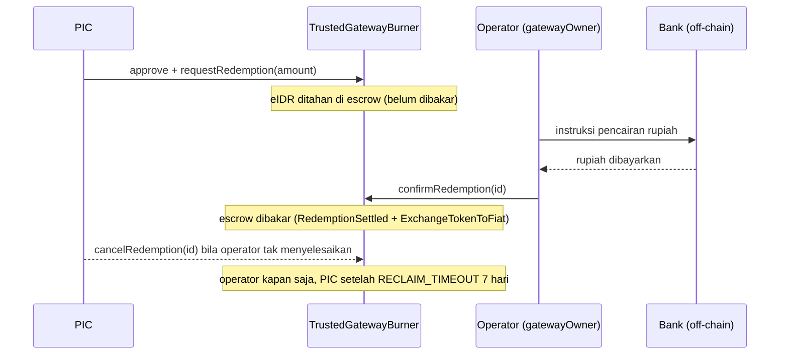

# @repo/blockchain: Smart Contracts (Hardhat 3 + Solidity)

Kontrak pintar GovernanceFund: **lapisan yang melindungi DANA**. Semua otoritas finansial
(multi-sig, voting, freeze, penebusan) ditegakkan di sini, on-chain, dan tidak bisa di-bypass dari
frontend maupun backend.

> Bagian dari monorepo [`governancefund`](../../README.md). ABI hasil compile disalin ke
> [`packages/shared`](../shared/README.md) untuk dipakai FE (Wagmi) dan BE (webhook + read call).
> `pragma solidity 0.8.35`, kompilasi memakai optimizer (200 runs) dan **`viaIR: true`**.

## Kontrak

| File | Peran |
|---|---|
| `IRupiahToken.sol` | Interface `mint()`, `burn()`, dan ERC-20 standar |
| `RupiahToken.sol` | ERC-20 **eIDR**, **non-transferable**, **0 desimal** (1 eIDR = Rp1). `mint` hanya `governanceContract`, `burn` hanya `gatewayContract`. Alamat keduanya dikunci sekali oleh deployer (`setGovernance`, `setGateway`) |
| `Web3Governance.sol` | Inti governance (`EIP712` + `AccessControl`, domain `GovernanceAntiCorruption` v`1`) |
| `TrustedGatewayBurner.sol` | Gateway penebusan fiat **dua fase** (escrow → settle) |

### eIDR (`RupiahToken`)

- Nama/simbol: `e-IDR Rupiah Token` / `eIDR`, `decimals() = 0`. Seluruh angka uang di sistem adalah
  **rupiah utuh**: angka yang dimasukkan PIC di aplikasi sama dengan integer yang di-`mint`,
  di-burn, dan tampil di wallet.
- `transfer(to, amount)` hanya lolos bila `to == gatewayContract` atau pengirim adalah gateway;
  `transferFrom` hanya boleh ke gateway. Selain itu revert (token tidak bisa dijual/dialihkan).
- Pasokan tidak tetap: bertambah saat penarikan (`mint-on-demand`) dan berkurang saat penebusan
  diselesaikan (`burn`).

> Catatan: beberapa komentar NatSpec lama di `IRupiahToken.sol` dan `executePicWithdrawal` masih
> menyebut "Wei (18 decimals)". Perilaku sebenarnya adalah **0 desimal** (lihat `decimals()`).

### Lima lapisan `Web3Governance`

1. **Governance admin BFT.** `proposeRoleGrant` / `proposeRoleDevote` (satu admin mengusulkan) →
   `voteRoleProposal` (tiap admin sekali) → eksekusi otomatis saat suara ≥ `⌊2N/3⌋ + 1`. Berlaku
   untuk `ADMIN_ROLE`, `VALIDATOR_ROLE`, `AUDITOR_ROLE`. `PIC_ROLE` **tidak** lewat voting:
   `grantPicRole` / `revokePicRole` oleh satu admin.
2. **Voting proposal validator.** `submitProposal` (`onlyRole(PIC_ROLE)`, butuh
   `totalValidatorsCount ≥ 3`) → `voteProposal` (validator, sekali per program, batas
   `VOTING_PERIOD` 7 hari) → `APPROVED` pada ambang BFT.
3. **Rilis milestone.** `executeMilestoneRelease` (hanya PIC program): rekonstruksi hash EIP-712,
   `ecrecover` ×3, validasi role Admin/Validator/Auditor, anti-kolusi (`historyOfSigners`),
   *cumulative budget guard*, urutan milestone harus berurutan → `DRAWABLE`.
4. **Micro-withdrawal.** `executePicWithdrawal` mencatat `WithdrawalRecord` on-chain (penerima +
   deskripsi) lalu `mint` eIDR ke PIC; `finalizeMilestone` menutup milestone tanpa menghabiskan
   kuota (sisa tidak pernah dicetak). Kuota nol → `MILESTONE_ACHIEVED`; milestone terakhir →
   `COMPLETED`.
5. **Freeze / unfreeze.** `forceFreezeProgram` (`onlyRole(AUDITOR_ROLE)`, saat `DRAWABLE` atau
   `MILESTONE_ACHIEVED`) → `proposeUnfreezeAppeal` (hanya PIC) → `voteUnfreezeAppeal(programId,
   approve)` oleh validator: suara *approve* ≥ ambang → kembali ke `DRAWABLE` (atau
   `MILESTONE_ACHIEVED` bila kuota nol); suara *reject* ≥ ambang → `FRAUD_CONFIRMED`; deadline
   lewat tanpa ambang → tetap `FROZEN`.

> Konsensus BFT: `threshold = ⌊(2 × N) / 3⌋ + 1`, dengan `N` = jumlah admin / validator aktif
> **saat suara di-cast**.

| N | 1 | 2 | 3 | 4 | 5 | 6 | 7 | 9 | 10 |
|---|---|---|---|---|---|---|---|---|---|
| Ambang | 1 | 2 | 3 | 3 | 4 | 5 | 5 | 7 | 7 |

Aturan lain yang ditegakkan on-chain:

- **One-address-one-role:** satu alamat tidak boleh memegang lebih dari satu role (Admin,
  Validator, Auditor, PIC).
- **Anti-kolusi:** mulai milestone indeks 1, ketiga penanda tangan tidak boleh pernah
  menandatangani milestone mana pun pada program yang sama.
- **Front-running protection:** hanya PIC program yang dapat mengirim `executeMilestoneRelease`
  (tanda tangan dikumpulkan off-chain, hanya PIC yang membayar gas).
- **Cabut PIC tidak membekukan** milestone berjalan; SOP yang dianjurkan: auditor freeze dulu,
  lalu admin `revokePicRole`.

### Status program (`ProposalStatus`, urutan enum tidak boleh diubah)

`PENDING → APPROVED → DRAWABLE ⇄ MILESTONE_ACHIEVED → COMPLETED`, dengan cabang
`FROZEN → (DRAWABLE | MILESTONE_ACHIEVED | FRAUD_CONFIRMED)`. Indeks numerik: `0 PENDING`,
`1 APPROVED`, `2 DRAWABLE`, `3 MILESTONE_ACHIEVED`, `4 FROZEN`, `5 COMPLETED`, `6 FRAUD_CONFIRMED`.

### Gateway penebusan dua fase (`TrustedGatewayBurner`)

Burn terjadi on-chain tetapi pencairan rupiah terjadi off-chain di bank, sehingga keduanya tidak
bisa atomik. Kontrak memecahnya agar tak ada pihak yang bisa curang:



- `requestRedemption(amount)` → status `PENDING`, event `RedemptionRequested`.
- `confirmRedemption(id)` (**hanya `gatewayOwner`**) → `SETTLED`, token escrow di-burn.
- `cancelRedemption(id)` → `CANCELLED`, token dikembalikan ke PIC (operator kapan saja; PIC setelah
  `RECLAIM_TIMEOUT` = 7 hari).
- `gatewayOwner` = alamat deployer gateway (satu operator tepercaya). Jendela clawback 72 jam untuk
  token baru **tidak** ditegakkan oleh kontrak (hanya kebijakan di UI).

### Event penting

`ProposalSubmitted`, `ProposalVoted`, `ProposalApproved`, `MilestoneReleased`,
`OnChainWithdrawalLogged`, `MilestoneFinalized`, `ProgramCompleted`, `ProgramForceFrozen`,
`UnfreezeAppealSubmitted`, `UnfreezeAppealVoted`, `ProgramUnfrozenViaBFT`,
`ProgramFraudConfirmed`, `RoleVoteCreated`, `RoleVoteCast`, `RoleGrantedViaGovernance`,
`RoleRevokedViaGovernance`, `PicRoleGrantedByAdmin`, `PicRoleRevokedByAdmin` (governance);
`RedemptionRequested`, `RedemptionSettled`, `RedemptionCancelled`, `ExchangeTokenToFiat` (gateway);
`TokenMinted`, `TokenBurned` (token). Backend mengonsumsi event ini lewat webhook Alchemy.

## EIP-712

Domain `GovernanceAntiCorruption` v`1`, chainId `84532`. Struct
`MilestoneApproval(uint256 programId, uint256 milestoneIndex, uint256 milestoneBudget, bytes32 evidenceHash)`
(**harus identik** dengan `packages/shared/src/constants/eip712.ts`). `verifyingContract` = alamat
`Web3Governance` yang live. `evidenceHash` adalah hash dokumen **persetujuan milestone** yang
ditandatangani ketiga pihak (bukan kuitansi per-penarikan).

## Struktur

```
contracts/     # IRupiahToken.sol, RupiahToken.sol, Web3Governance.sol, TrustedGatewayBurner.sol
scripts/
  deploy.ts            # urutan deploy (lihat di bawah)
  test-scenario.ts     # skenario end-to-end Phase 1-11 (log berformat, memakai jaringan hardhat in-process)
  revoked-7702.ts      # utilitas: cabut delegasi EIP-7702 pada akun deployer (viem)
hardhat.config.ts      # Hardhat 3: defineConfig(), jaringan hardhat (edr-simulated) + base_sepolia (http)
```

Folder `test/` **belum ada** (konfigurasi menunjuk `./test`), sehingga `pnpm test` tidak menjalankan
test. Validasi perilaku dilakukan lewat `test-scenario`, yang mencakup 11 fase: deploy dan penguncian
link kontrak, onboarding multi-admin + ambang BFT dinamis, voting role (Validator/Auditor), registrasi
PIC dan percobaan bypass peretas, siklus proposal + voting validator, struktur EIP-712, penarikan
dengan jejak forensik on-chain, anti-kolusi antar-milestone, freeze auditor, banding unfreeze
(approve menang), dan penebusan fiat di gateway.

## Perintah

```bash
pnpm --filter @repo/blockchain compile          # hardhat compile
pnpm --filter @repo/blockchain test-scenario    # skenario end-to-end (jaringan hardhat lokal)
pnpm --filter @repo/blockchain deploy-base      # deploy ke Base Sepolia (butuh .env)
pnpm --filter @repo/blockchain verify           # hardhat verify --network base_sepolia <args>
pnpm --filter @repo/blockchain fix-delegation   # jalankan revoked-7702.ts (cabut delegasi 7702)
pnpm --filter @repo/blockchain typecheck        # tsc --noEmit
```

**Urutan deploy (kritikal):** `RupiahToken` → `TrustedGatewayBurner(token)` →
`Web3Governance(token, rootAdmin = deployer)` → `token.setGovernance(gov)` →
`token.setGateway(gateway)`. Dua setter terakhir hanya bisa dipanggil sekali.

> **Setiap redeploy:** (1) perbarui `contract.ts` **dan** `verifyingContract` di `eip712.ts` pada
> `packages/shared`; (2) salin ulang artifact ABI ke `packages/shared/src/abi/`; (3) arahkan ulang
> webhook Alchemy ke alamat baru. Bila tidak, semua tanda tangan milestone gagal diam-diam dan
> event tidak masuk database. Data lama di database tidak akan cocok dengan kontrak baru.

## Environment (`.env`)

| Variabel | Keterangan |
|---|---|
| `ALCHEMY_BASE_SEPOLIA_RPC_URL` | RPC Base Sepolia |
| `DEPLOYER_PRIVATE_KEY` | Kunci deployer (juga root admin awal). **Jangan commit** |
| `ETHERSCAN_API_KEY` | Untuk `hardhat verify` |

Ethers.js hanya dipakai lewat plugin Hardhat (script deploy/skenario); `viem` dipakai di
`revoked-7702.ts`. Jangan mengimpor Ethers ke `apps/*`.

## Alamat Ter-deploy (Base Sepolia, 84532)

Sumber kebenaran: [`packages/shared/src/constants/contract.ts`](../shared/src/constants/contract.ts).

```
RupiahToken            0x7dc8b7C37ecDA42328105d00ae23cBD9239db0A9
TrustedGatewayBurner   0x76070Ce481c088B219FDef8F6ef0CcF91391C0A0
Web3Governance         0x89AB7D9EBefa836F44c50f51F7d2c2831188421a
Deployer               0x3ff8C245C6499062A98Ed214EA606Ec5fa2627Dd
```

Block explorer: https://sepolia.basescan.org
